# @carrel/desktop

The Carrel desktop app: Electron main process (bundled with esbuild) and a
React renderer (bundled with Vite).

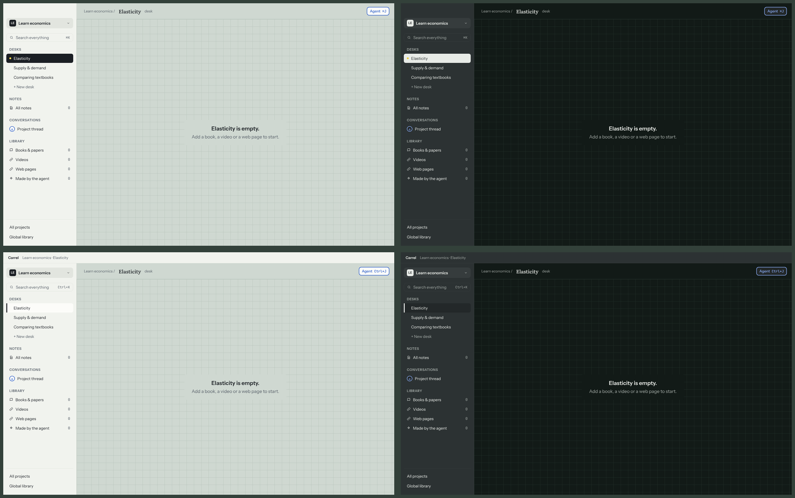

## Run

```sh
pnpm dev                                   # build and open
pnpm --filter @carrel/desktop smoke        # start, check the shell renders, quit
```

## App icon


“c.”: Margin `paper`, the *that.* highlighter and Literata 500, outlined so it
needs no font. The sources are `build/icon.svg` (Windows and Linux) and
`build/icon-mac.svg` (on Apple's 1024 grid with its shadow). `pnpm --filter
@carrel/desktop icons` redraws `icon.png`, `icon.ico`, `icon.icns` and
`icon-mac.png` from them with Electron. The window uses the .ico on Windows;
on Mac the dock shows `icon-mac.png` in development and the .icns once packaged.

## Projects and desks

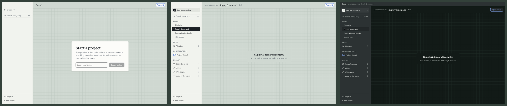

On first start Carrel asks for a project name. Projects live in visible
folders, and a restart reopens the project and desk you left:

```
~/Carrel/<project>/
  project.json            id, name, desk order
  desks/<desk id>.json    name, viewport, sheets
  events.jsonl            every change, with its actor
~/.carrel/settings.json   the open project, and the open desk per project
```

The main process owns these files (`@carrel/core`'s `Workspace`); the renderer
asks over IPC and gets a summary back. The smoke check creates a project and a
desk in a temporary home, restarts, and checks they come back.

## The desk

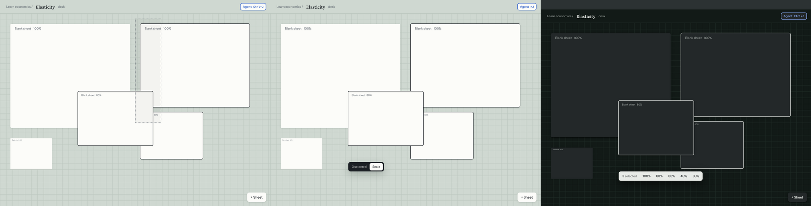

| Do | How |
| --- | --- |
| Add a blank sheet | Double-click the mat, or **+ Add**, Blank sheet |
| Move | Drag a sheet's label row; snap guides show near other sheets |
| Resize | Drag one of the eight handles of a single selected sheet |
| Select | Click a label; Shift-click to add; drag a marquee on the bare mat; ⌘A / Ctrl+A |
| Scale | **Scale** in the selection bar, then 100–30% |
| Pile | Select two or more, **Make a pile**: they stack at 30% under a "Pile · N" label. Drag the label to move the pile, click it to select it, **Spread out** to lay it out in a row |
| Delete | Delete or Backspace |
| Undo, redo | ⌘Z / Ctrl+Z, ⇧⌘Z / Ctrl+Shift+Z or Ctrl+Y |
| Clear the selection | Esc, or click the bare mat |
| Pan | Two-finger scroll, Space-drag, or drag with the middle button; or click and drag on the map |
| Zoom (25–200%) | Pinch, ⌘/Ctrl-scroll, ⌘+ and ⌘− (Ctrl on Windows), or − and + on the pill |
| Actual size, fit all | ⌘0 or click the percentage; ⌘1 or **Fit** |
| Tidy up | **Tidy up** on the pill: rows in reading order, as wide as the screen; piles move whole. One undo step |

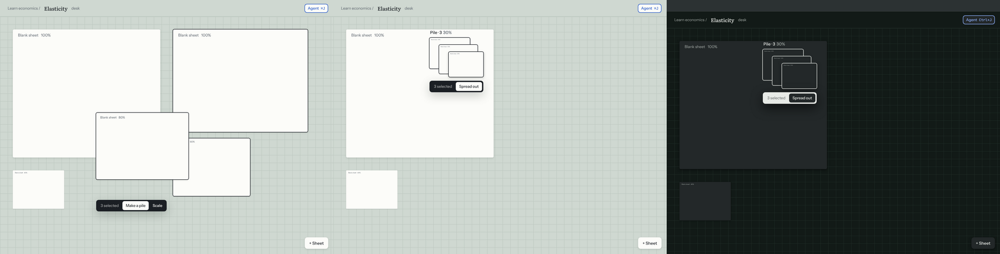

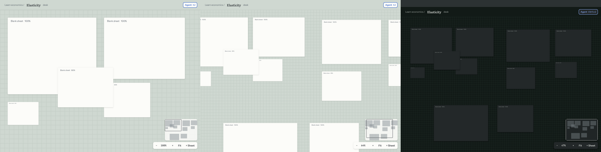

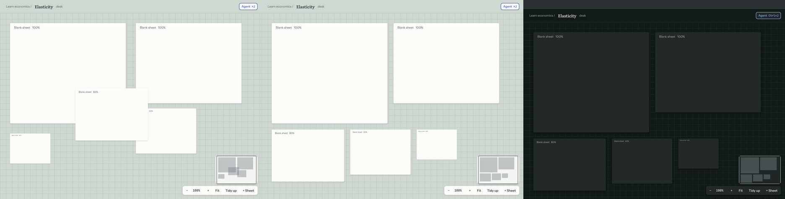

The view (pan and zoom) is saved with each desk and comes back after a
restart; it isn't an event, since it doesn't change the desk. Only sheets
near the screen are mounted.

Each finished gesture is saved and logged as one event, and is one undo step.
Undo history lasts while the desk is open.

## Sources

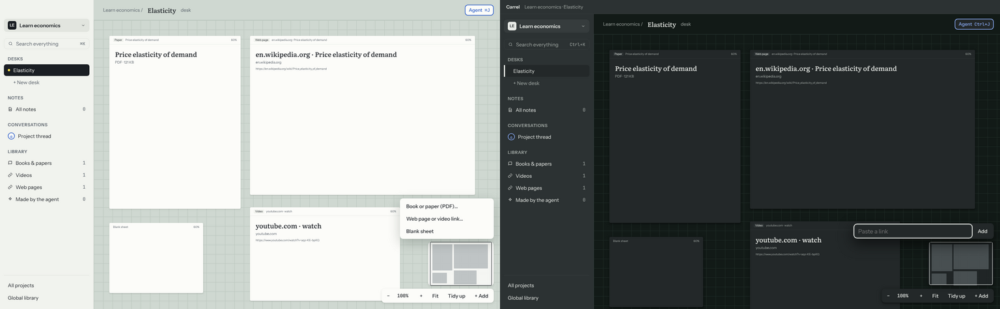

**+ Add** on the pill adds a book or paper (PDF), a web page or video link,
or a blank sheet. You can also drop PDFs or links on the desk, or paste a
link anywhere but a text field. A source becomes an item of the project and
a sheet on this desk; the sidebar counts them.

```
~/Carrel/<project>/items/<item id>/
  item.json           kind, title, who added it, and where the source is
  <file>.pdf          a stored book or paper, copied in
```

Web pages and videos are linked by URL and never downloaded. Until each
kind's viewer comes, a sheet shows the source's title and where it is.

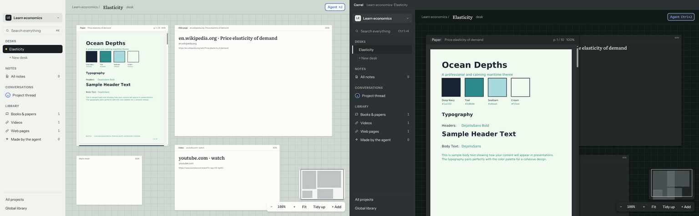

**PDFs** open inside their sheet with pdf.js: scroll over the sheet to read,
the label shows the page, and text can be selected. Only pages near the view
are drawn, at a resolution matched to the sheet's scale and the desk zoom.

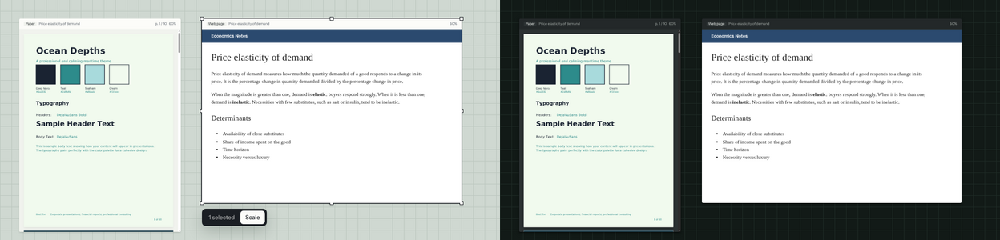

**Web pages** open when you click into their sheet. Only one page is live at
a time, and only while its whole sheet is in view with nothing over it; the
page zooms to the sheet's scale. Every other web sheet shows the snapshot the
page left when it stopped being live (Esc, a click elsewhere, a drag). The
snapshot is kept as `snapshot.png` beside the item. When a page loads, its
title replaces the name made from the link, unless you renamed it. Links
that open new windows go to your browser.

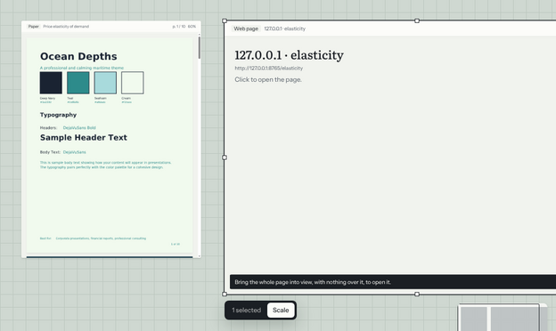

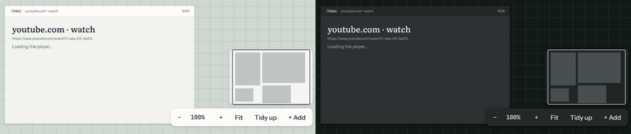

**YouTube videos** play on their sheet in YouTube's privacy-enhanced embed.
Nothing autoplays; a link's `t=` sets where it starts. The label shows the
current time, and the player's title replaces the name made from the link.
Starting one video pauses the others: one audio source at a time. The player
stays hidden until it answers, so if it can't load, the sheet says so instead
of showing an error page. Videos from other sites open like web pages.

The desk is served from `https://desk.carrel.app/`, intercepted inside the
app, because YouTube's embed refuses `file://` pages. Web pages on the desk
get their own session, apart from the desk's.

## that.

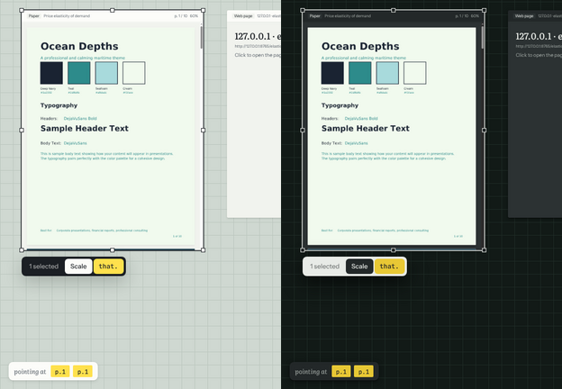

Select words in a PDF, select a playing video's sheet, or ⌥-drag a region,
and press **⌘ .**
(Ctrl+. on Windows) or **that.** on the selection bar. In a live web page,
select words and press ⌘ . there. Carrel keeps a *that.* in the project and
puts its chip on the tray at the bottom left: the page (`p.42`), the moment
(`▶ 12:34`) or the site. Hover a chip for its words; × takes it off the tray
but keeps it.

```
~/Carrel/<project>/anchors/
  <id>.json   the item, W3C selectors (page or moment, quote, position), the quoted words
  <id>.png    the video frame, for a moment
```

Text selectors are relative to the page for a PDF and to the page's text for
a web page, so a *that.* can be found again when the source shifts.

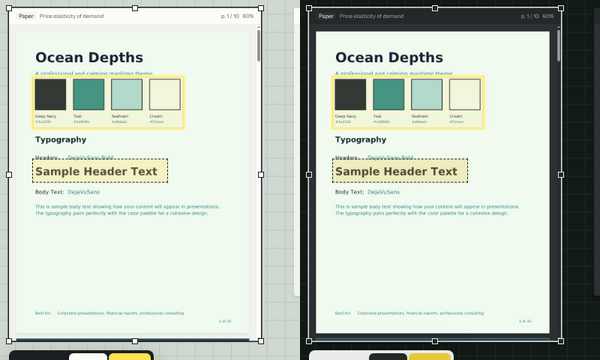

**Regions.** Hold ⌥ (Alt) and drag over a source to draw a box, then press
⌘ . to keep it, or Esc to drop it. On a PDF the box is kept in percent of
its page, so it lands in the same place at any size, and opening its chip
shows the box on the page. Every region keeps a picture of what it covered;
on a web page or a video, opening it shows that picture (a video also seeks
to its moment).

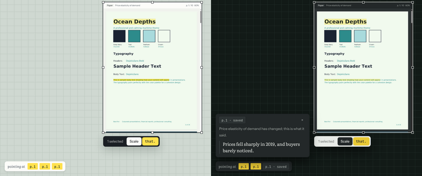

**Opening a chip** finds its spot again. The sheet comes to the middle of the
view and to the top. A PDF scrolls to the words and brightens their band; a
video seeks to the moment; a web page goes live and scrolls to its words.
Each *that.* is looked for at its exact position first, then by its quote and
the words around it. When the words are gone, the chip turns grey ("saved")
and shows what it said when it was made. Every *that.* on a PDF page or a web
page keeps a soft yellow band under its words. The tray shows the *that.*s of
the sources on this desk, so chips come back after a restart.

## Notes

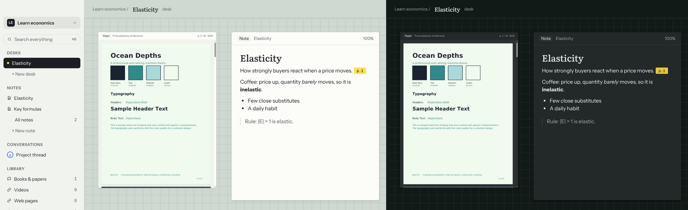

**+ New note** in the sidebar lays an empty note on the desk, ready to type:
its first line is its title. Click a note in the sidebar to bring it forward,
or to lay it on this desk. A note saves itself a moment after you stop
typing. Headings, lists, quotes, **bold**, *italic* and `code` are kept.

Notes are plain Markdown, so they read fine outside Carrel. A *that.* chip is
a link to its anchor:

```
~/Carrel/<project>/notes/<id>.md
  ---
  id: …
  title: "Elasticity"
  created: …
  updated: …
  ---
  # Elasticity

  How strongly buyers react when a price moves. [p.42](that:<anchor id>)
```

### Citing a *that.*

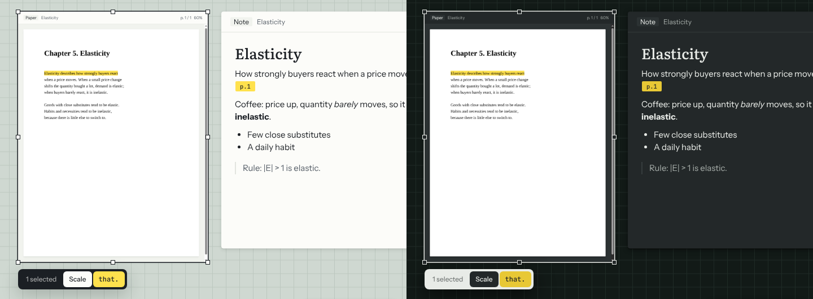

Drag a chip from the tray into a note to cite that spot there. Click a chip
in a note to open its source at the spot, the same as a chip on the tray.

### Tags and backlinks

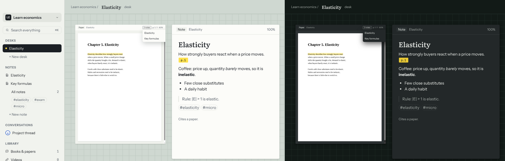

Type a `#tag` anywhere in a note. The sidebar lists every tag under Notes;
pick one to list all its notes. A source's label says how many notes cite
it; click it to bring the note forward, or pick one when there are several.
A note ends with what it cites ("Cites a paper and a video.").

## Search

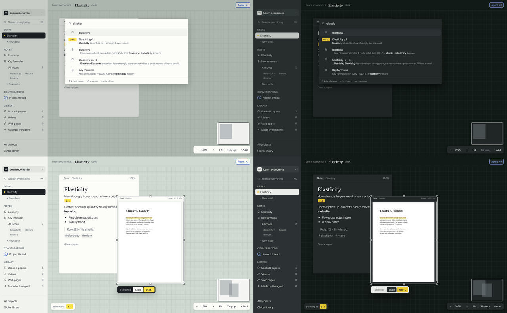

Press ⌘K (Ctrl+K), or click Search everything in the sidebar, and type. It
searches the open project: notes, source titles, the words of each *that.*,
and the text of every PDF page. Every word must match; the last may be half
typed. Arrows choose, Enter opens: a note or source comes forward (or is laid
on the desk), a *that.* opens at its spot, and a page scrolls its PDF there.
Matches are bold, never yellow (yellow means *that.*).

The index is SQLite full-text search in `~/.carrel/index/<project>.sqlite`,
rebuilt from the project's files as needed. A PDF's pages are read once when
it is added, and again only if its file changes.

## The agent

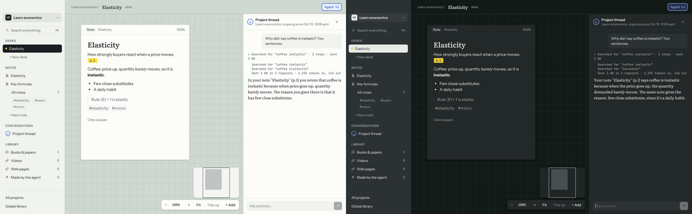

Press ⌘J (Ctrl+J), or click Agent at the top or Project thread in the
sidebar. The project's ongoing thread docks on the right and the desk makes
room. Ask in the box at the foot (Enter sends, Shift+Enter adds a line). The
agent searches the project (notes, sources, *that.*s, PDF pages) before it
answers about what you have read or noted.

Each answer opens with one folded line: what the agent did and what it sent
("▸ Searched for “coffee” · 2 steps · sent 3 KB"). Open it for every step and
the tokens the model reported. The header keeps the thread's running total.

The thread is kept in the project as `threads/project.jsonl`, one line per
turn with its steps and cost, so it outlives any model. tnega's own state
lives in `~/.carrel/agent/`.

### Pointing and citing

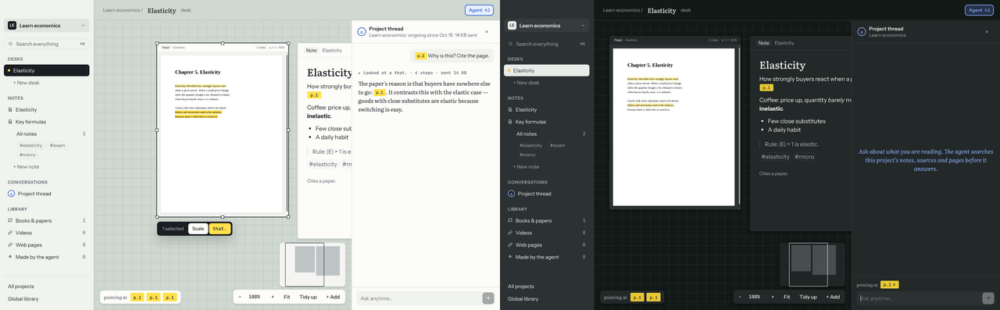

The *that.*s you make go with your next question: they show above the box
as "pointing at" chips (× to drop one). The agent also hears what is on the
desk and what is selected. It reads with `read_item` (a note, or PDF pages),
`resolve_that` and `search_project`, and cites with `make_that`, which
points at exact words on a PDF page. Its chips in the answer open the spot,
laying the source on the desk if it isn't there; *that.*s it made are marked
as the agent's.

### Proposals in pencil

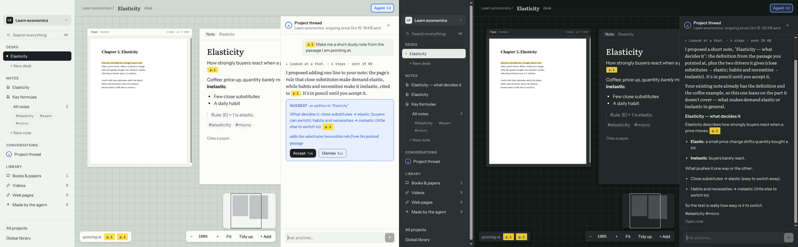

The agent never writes. Ask it for a note ("make me a short note from
this") and it proposes one with `propose_note_edit`: a new note, or words
added at the end of one of yours. It can also propose a web page or video
with `propose_source`. A proposal sits under the answer in pencil (dashed
blue, a SUGGEST tag) until you decide: **Tab** accepts the newest one,
**Esc** dismisses it (while the box is empty), or use the buttons. Accepting
inks it and writes it; "Open note" lays it on the desk. Proposals are kept in
`~/Carrel/<project>/proposals/`, and the events log says who proposed and who
accepted.

### Keeping a turn

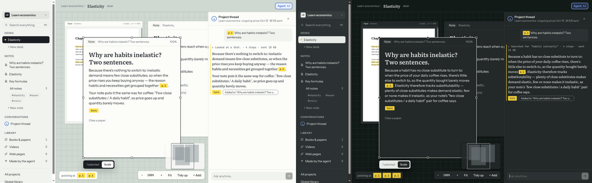

Under each answer, hover for **that.** and **Add to note**. *that.* points at
the turn itself: it keeps a highlighter stroke in its margin and a `turn`
chip you can drag into a note. Clicking a `turn` chip anywhere opens the
thread at that turn, and it brightens. **Add to note** copies the answer and
a chip back to it into the note selected on the desk, or into a new note
titled with your question. That is your own edit, so it is written at once.

### Side threads

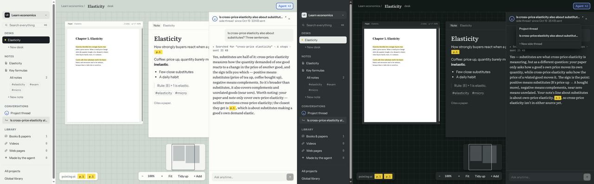

A topic that deserves its own conversation gets a side thread. Click the
thread's name at the top of the panel for the Threads menu, then **New side
thread**; your first question names it. Side threads are listed under the
project thread in the sidebar, and they use the same tools, proposals and
*that.*s. Each is a tnega Thread under the project's coordinator, and its
turns are kept in `~/Carrel/<project>/threads/<id>.jsonl`, with the list in
`threads/side-threads.json`.

**The model.** DeepSeek (`deepseek-flash`) by default. The first time, the
panel asks for a key and keeps it in `~/.carrel/model.json`, encrypted by the
system keychain. `CARREL_LLM_API_KEY` overrides it; `CARREL_LLM_BASE_URL` and
`CARREL_LLM_MODEL` pick another OpenAI-compatible route. `CARREL_LLM=scripted`
answers with a stand-in model that needs no network (the smoke check uses it).

## Frames

- **Mac:** hidden inset title bar; the traffic lights sit over the sidebar,
  whose top and the top bar move the window.
- **Windows:** the app draws a title strip; the native minimize, maximize and
  close buttons sit on it (`titleBarOverlay`) and follow the theme.
- **Other platforms:** the system frame.

The theme follows the system's light or dark mode.

For screenshots, these environment variables pick what you'd see elsewhere:

| Variable | Does |
| --- | --- |
| `CARREL_FRAME=mac\|windows` | Draw that platform's frame (the traffic lights themselves only show on a Mac) |
| `CARREL_THEME=day\|night` | Force a theme |
| `CARREL_SHOT=file.png` | Save the page as a PNG and quit |
| `CARREL_HOME=folder` | Use `folder/Carrel` and `folder/.carrel` instead of your home folder |
