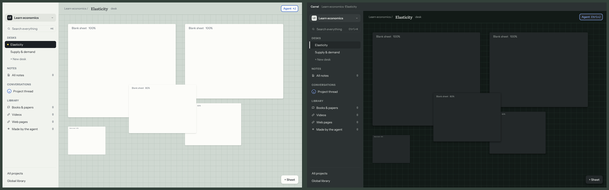

# @carrel/desk

The desk engine's rules, as pure functions with no DOM: sheet footprints,
moving, resizing by eight handles, scaling (30–100%), raising, snap guides,
where a new sheet goes, piles, Tidy up, the view (pan and zoom), and undo
history. The app's renderer draws with them.

A sheet keeps its full size (`w`, `h`) and a `scale`; its footprint on the desk
is the size times the scale, with `x`, `y` at the top-left. Every function
returns new sheets and leaves its input alone, so a gesture previews from its
start and undo can keep the old state.

Undo history (`record`, `undo`, `redo`) keeps each step as the desk before and
after it, up to 200 steps. Doing something new clears what could be redone.
