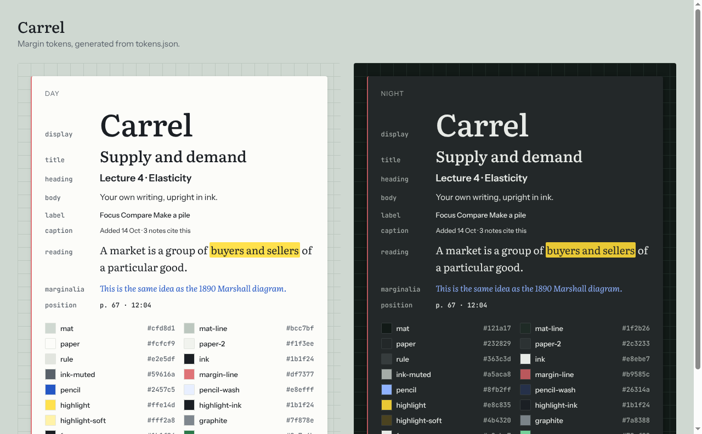

# @carrel/margin

Margin, Carrel's design system, as code. The source of truth is Margin's
`tokens.json` (copied in [`.agent/design/margin/`](../../.agent/design/margin/));
this package turns it into CSS variables and a typed `tokens` object.



## Use

```ts
import '@carrel/margin/margin.css' // fonts + variables
import { tokens, contrast } from '@carrel/margin'
```

- Day is the default. Set `data-theme="night"` (or `"day"`) on any element to
  pick a theme for that subtree. With no choice on the root, the system's dark
  mode picks Night.
- Colors: `var(--ink)`, `var(--pencil)`, `var(--highlight)`, ...
- Type: `font: var(--text-reading)`; display also has `--text-display-tracking`.
- Spacing `--space-1` to `--space-12`, radii `--radius-mark`, `--radius-sheet`,
  `--radius-control`, `--radius-seat`.
- Fonts (Instrument Sans, Literata, JetBrains Mono) are bundled, so the app
  works offline.

## Change a token

Change it in the Margin design system first, copy the new `tokens.json` into
`.agent/design/margin/`, then:

```sh
pnpm --filter @carrel/margin tokens
```

The tests fail if the generated files are stale, and they check contrast for
ink, pencil and highlight in both themes.
