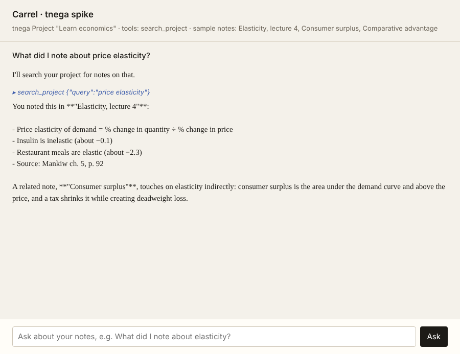

# Spike: tnega integration

Throwaway prototype for phase 1 of the development plan. It answers one
question: can Carrel create a tnega Project, send a message, stream the answer,
and register one Carrel tool the agent calls? **Yes.**



## Try it

```bash
pnpm install
pnpm test spikes                      # scripted model, no key needed

export CARREL_LLM_API_KEY=sk-...      # a DeepSeek key by default
pnpm --filter @carrel/spike-tnega app # window: ask about the three sample notes
pnpm --filter @carrel/spike-tnega demo "What did I note about elasticity?"   # same, in the terminal
```

Other OpenAI-compatible routes: set `CARREL_LLM_BASE_URL` and `CARREL_LLM_MODEL`.
The window keeps its project in `~/.carrel/spike-tnega/`, so a restart shows the
earlier conversation. Delete that folder to start over.

## What it proved

- **Create and reopen a tnega Project** from the published `tnega@0.5.0`
  package (`tnega/project-local` on `tnega/blackboard-local`). The conversation
  survives a reopen because it lives in the Box and the agent's Session.
- **Send and stream.** A user message goes into the project's Box; tnega's
  Project Loop delivers it to the project thread's agent; `assistant/chunk`
  Session events stream to the window over IPC. With DeepSeek Flash the first
  chunk arrived about 2.5 s after asking, including one tool round trip.
- **One Carrel tool.** `search_project` is a plain tnega `ToolDefinition`
  registered on the project's `tools` service. The live model called it and
  cited the right note; a test with a scripted model checks the same path.
- **Runs in Electron's main process** with tnega loaded from `node_modules` as
  published (not bundled).

## What it changed

- **Don't use tnega's `ProjectHost`.** It is exported (`tnega/cli/runtime`),
  but its coordinator only sees a fixed list of tools
  (`COORDINATOR_TOOLS` in tnega's `project-tool-scope.ts`) and its prompt sends
  all real work to sub-Threads. Carrel's project thread is a direct study
  partner, so Carrel composes its own Project scope from tnega's seams
  (`src/carrel-project.ts`, about 150 lines) with its own prompt. This matches
  "Carrel features are tnega plugins", but it means Carrel picks its own
  approvals, sandbox and memory instead of inheriting ProjectHost's.
  Alternative: ask tnega to make the coordinator's tool list and prompt
  configurable.
- **Watch for failed turns.** When the model call fails, no reply is published;
  the caller must listen for a `turn/end` with `finishReason: "error"`, or it
  waits forever. The spike does this.
- **Keep the event loop alive in headless use.** The Project Loop delivers on an
  unref'd timer, so a plain Node script can exit before the agent runs.
  Electron is unaffected.

## Open for later

- `tnega/browser` is not in the published package's exports. The live-web
  spike needs it, or Carrel drives `WebContentsView` itself.
- tnega names project folders by UUID. Milestone 1 task 4 needs a mapping from
  `~/Carrel/<project>/` (by name) to the tnega project id.
- The streamed text includes the model's short preamble before a tool call
  ("I'll search…"); the published reply only has the final message. The agent
  panel should fold the preamble into the steps line.
