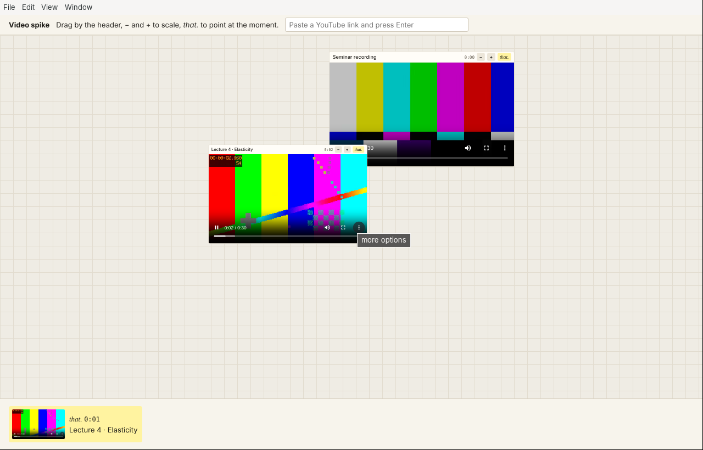

# Spike: video on the desk

Throwaway prototype for phase 1 of the development plan. The question: with
an embedded player in a scaled, dragged sheet, can we read the current time
for *that.* and capture a frame? **Yes for local video, checked here and in CI
on Mac and Windows. Partly for YouTube:** on CI the embed loads, the
postMessage handshake works (`onReady`, `infoDelivery`), but the video never
starts on GitHub's runners, so the time stays 0. That looks like YouTube
holding back playback for datacenter machines; it needs one try on a real Mac.
The YouTube step is informational in CI and doesn't fail the build.



## Try it

```bash
pnpm install
pnpm --filter @carrel/spike-video app     # two local videos; paste a YouTube link in the bar to add one
pnpm --filter @carrel/spike-video check   # scripted check
CARREL_SPIKE_YOUTUBE=aqz-KE-bpKQ pnpm --filter @carrel/spike-video check   # include YouTube
```

Drag a sheet by its header, scale it with − and +, press *that.* to point at
the moment. The chip on the shelf keeps the time and the frame.

## How it works

- **Players are DOM, not native views.** A `<video>` or a YouTube `<iframe>`
  sits inside an ordinary sheet, so dragging and CSS scaling just work, unlike
  web pages (see the live-web spike).
- **Current time.** Local video: `video.currentTime`. YouTube: its embed
  speaks a small postMessage protocol (`listening`, then `infoDelivery` with
  `currentTime` and `playerState`; commands like `playVideo` go back the same
  way), so no YouTube script is loaded into the desk.
- **Frame.** `webContents.capturePage(rect)` on the window, with the player's
  on-screen rectangle. It works the same for same-origin video and
  cross-origin iframes, where a canvas can't read pixels.
- ***that.*** A W3C `FragmentSelector` with a media fragment (`t=754.3`) plus
  the frame as the snapshot.
- **One audio source at a time.** Starting one player pauses the others.

## What it found

1. **The desk must have an https origin.** YouTube's embed refuses a `file://`
   page, and its postMessage replies go only to the `origin` it was given. The
   spike serves the desk from `https://desk.carrel.app/` by intercepting only
   that host with `protocol.handle('https')`; every other request passes on.
   The real app should do the same from milestone 1.
2. **A frame capture is "what you see".** It includes the player's own
   controls and anything overlapping the sheet. For *that.*, hide controls for
   the capture (custom controls on the sheet), and raise the sheet first.
   For local files, drawing the `<video>` to a canvas gives a clean frame.
3. **Scaling is free.** Time and capture keep working at 60%; the frame is
   captured at the scaled size (288×162 for a 480×270 player), so capture at
   100% or upscale when the frame matters.
4. Capture took about 17–23 ms here, 7–23 ms on the Windows runner and
   140–440 ms on the Mac runner (no GPU).
5. **The YouTube handshake needs repeating.** Sending `listening` once on the
   frame's load is too early; the player's script isn't ready. Repeat it every
   250 ms until the player answers, as YouTube's own iframe API does, then
   send `playVideo` on `onReady`.

## Open for later

- Other sites (Vimeo, Bilibili, course platforms) each need their own small
  adapter (`time`, `play`, `pause`). Sites with no API fall back to the native
  view while focused, as the design says.
- The floating mini player and captions are later work.
