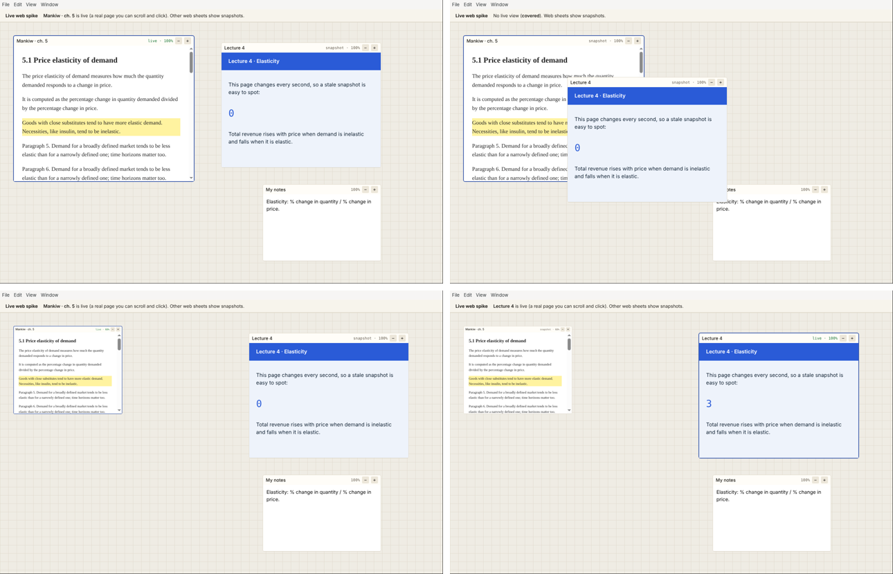

# Spike: live web on the desk

Throwaway prototype for phase 1 of the development plan. The question: can one
`WebContentsView` placed over a DOM sheet, swapped for a `capturePage()`
snapshot when inactive or overlapped, feel seamless? **Yes, with two rules
below.**



Top left: the active textbook sheet is a real, scrollable page. Top right: the
lecture sheet was dropped on it, so it became a snapshot. Bottom left: scaled
to 60%, it's live again with the page zoomed to match. Bottom right: the
lecture sheet is live (its clock reads 3) while the textbook shows its snapshot.

## Try it

```bash
pnpm install
pnpm --filter @carrel/spike-web app      # local pages
CARREL_SPIKE_REAL=1 pnpm --filter @carrel/spike-web app   # two Wikipedia pages (not tried here: no network)
pnpm --filter @carrel/spike-web check    # scripted check with timings (CI runs it on Mac and Windows)
```

Click a web sheet to make it live; drag sheets by their header; − and + scale
them. The status bar says which sheet is live, or why none is.

## Choice: Electron's own WebContentsView, not tnega's browser seam

`tnega/browser` isn't in the published npm package. This spike doesn't need
it: placing and snapshotting pages is plain Electron (`WebContentsView`,
`setBounds`, `setVisible`, `setZoomFactor`, `capturePage`). tnega's browser
seam matters later, when the agent drives a page (it attaches Playwright over
CDP to an embedded view). For that we'll need tnega to export it, or a git
dependency; that's a phase 6 question.

## What it proved

- **Placement is exact.** The view's bounds match the DOM sheet's page area to
  the pixel, including under a scaled sheet (`src/live-policy.ts`, unit-tested).
- **Scaling doesn't need a snapshot.** A sheet at 30–100% stays live:
  `setZoomFactor(scale)` makes the page match the sheet. The design assumed
  scaled sheets would show snapshots; they don't have to.
- **The swap is fast.** Capturing a visible view took about 2–17 ms here
  (software rendering in a container); live → snapshot including a fresh
  capture took 13 ms on average, about one frame. CI prints the same numbers
  for Mac and Windows.
- **Only overlap, dragging and leaving the desk force a snapshot.** Everything
  else can stay live.

## Rules it found

1. **Capture before hiding, never after.** A view that is hidden, has never
   been shown, or is positioned off-screen can't be captured ("Current display
   surface not available"). So the live view is captured just before it goes
   (a few ms), and every second while live as a fallback.
2. **A web sheet needs one moment on screen before it has a snapshot.** The
   spike shows each new web sheet in place for 80 ms at start. The app should
   save snapshots to `~/Carrel/<project>/` so a restored desk shows them at
   once, and a newly added sheet is live anyway because it's active.

## Open for later

- While a live sheet is covered mid-drag, the native view stays on top for the
  capture's frame. Fine in practice; worth a second look on slow machines.
- Snapshots are stale by design: the lecture clock in the snapshot still reads
  0. A badge with the snapshot's age may help.
- Inactive web sheets keep their page alive (hidden), which costs a renderer
  process each. With many web sheets, unload old ones and keep only the
  snapshot and URL.
